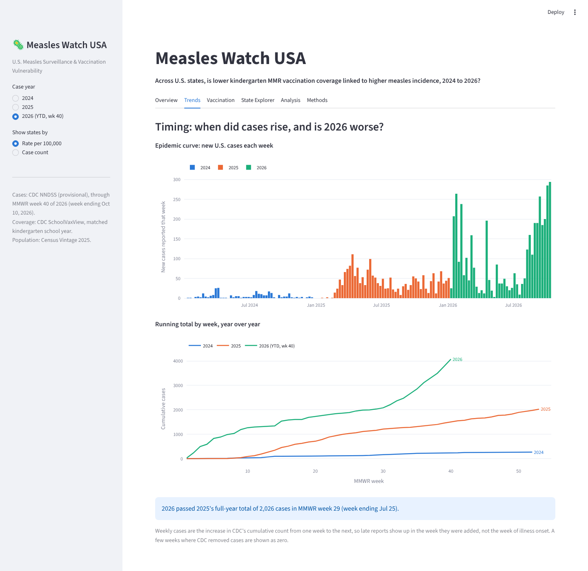

# Measles Watch USA

*U.S. Measles Surveillance & Vaccination Vulnerability Dashboard*

[Live Dashboard](https://measles-watch-usa.streamlit.app) <!-- replace with your real link -->

An interactive dashboard examining whether state-level gaps in kindergarten MMR coverage and rising vaccine exemptions track with measles incidence across the U.S., 2024 to 2026.

 <!-- add a screenshot named screenshot.png -->

## Research question
Across U.S. states, is lower kindergarten MMR vaccination coverage linked to higher measles incidence?

**Hypothesis:** States with MMR coverage below 95% and higher exemption rates have higher measles rates per 100,000 people.

**Design:** Ecological study of 50 states + DC, January 2024 to the latest reported week of 2026, with each case year matched to the preceding kindergarten school year (2024 → 2023-24, 2025 → 2024-25, 2026 → 2025-26).

## What's inside
- **Overview:** national totals and a U.S. map of cases or cases per 100,000
- **Trends:** weekly epidemic curve and year-over-year cumulative cases
- **Vaccination:** state MMR coverage against the 95% target, and exemption rates
- **State Explorer:** a profile for any state
- **Analysis:** MMR coverage (or exemptions) vs. measles incidence, Spearman correlation, below-vs-above-95% comparison
- **Methods:** data sources, definitions, and limitations

## Data sources
| Data | Source |
|---|---|
| Weekly measles cases | [CDC National Notifiable Diseases Surveillance System (NNDSS)](https://data.cdc.gov/d/x9gk-5huc), provisional |
| MMR coverage and exemptions | [CDC SchoolVaxView, kindergarten vaccination coverage and exemptions](https://data.cdc.gov/d/ijqb-a7ye) |
| State population | [U.S. Census Bureau, Vintage 2025 estimates (NST-EST2025-ALLDATA)](https://www.census.gov/data/tables/time-series/demo/popest/2020s-state-total.html) |

## Run it yourself
```bash
pip install -r requirements.txt
python clean_data.py      # downloads and cleans the data
streamlit run app.py      # opens the dashboard
```
Already downloaded the CSVs? Put them in `data/raw/` and run `python clean_data.py --raw data/raw`.

## A note on counting cases
NNDSS's "Current week" column is frozen when first published, so it never picks up late reports. Adding it up gives 676 measles cases for 2025, against CDC's cumulative year-to-date total of 2,026. This project defines each week's cases as the increase in the cumulative count, so adding up the weeks reproduces CDC's total exactly.

## Project files
```
measles-watch-usa/
├── app.py                 # Streamlit dashboard (6 tabs)
├── clean_data.py          # download, clean, merge
├── requirements.txt
├── data/
│   ├── measles_cases.csv       # state × week
│   ├── population.csv          # state × year
│   ├── mmr_coverage.csv        # state × school year
│   └── measles_state_year.csv  # merged: 51 states × 3 years = 153 rows
└── .streamlit/config.toml
```

## Tools
Python, pandas, Plotly, Streamlit

## Author
Saloni Patil, MPH (Epidemiology & Biostatistics), Boston University School of Public Health
